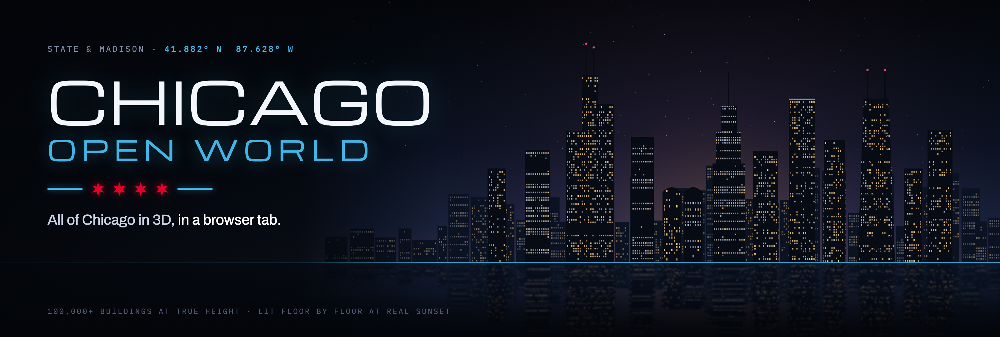
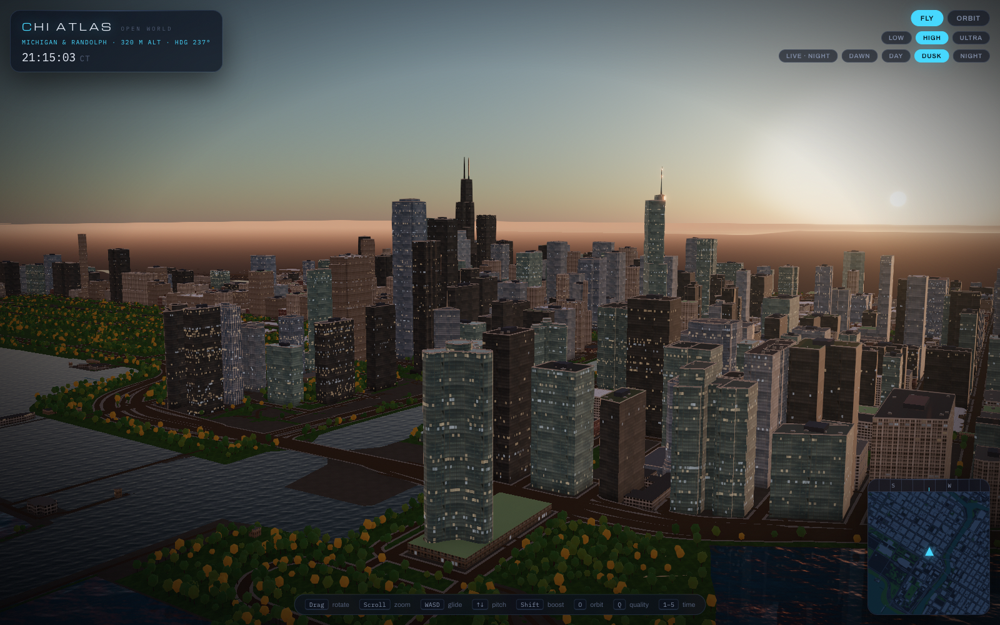
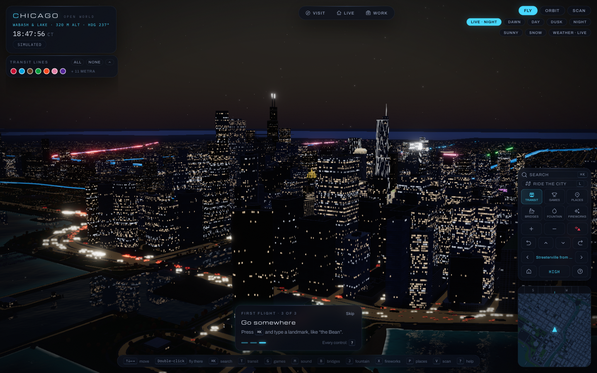

<div align="center">

<a href="https://chicago-open-world.vercel.app"></a>

&nbsp;

<a href="https://chicago-open-world.vercel.app"></a>


<a href="LICENSE"></a>
<br/>


&nbsp;

<a href="https://chicago-open-world.vercel.app"><kbd> &nbsp; <strong>Fly it</strong> &nbsp; </kbd></a> &nbsp;
<a href="#why-i-built-it"><kbd> &nbsp; <strong>Why I built it</strong> &nbsp; </kbd></a> &nbsp;
<a href="#how-the-buildings-are-drawn"><kbd> &nbsp; <strong>The buildings</strong> &nbsp; </kbd></a> &nbsp;
<a href="#whats-in-it"><kbd> &nbsp; <strong>What's in it</strong> &nbsp; </kbd></a> &nbsp;
<a href="#run-it"><kbd> &nbsp; <strong>Run it</strong> &nbsp; </kbd></a> &nbsp;
<a href="docs/TOUR.md"><kbd> &nbsp; <strong>Full tour</strong> &nbsp; </kbd></a>

</div>

All of Chicago in 3D, in a browser tab. More than 100,000 buildings stand at their true heights,
built from City of Chicago and OpenStreetMap data, and their windows light up floor by floor as the
real sun goes down. You can fly it like a drone, ride the L, walk the Riverwalk at the water, or
drive Lower Wacker under the street.

**Fly it:** [chicago-open-world.vercel.app](https://chicago-open-world.vercel.app). It works best
on a laptop or desktop with a recent browser.

<p align="center">
  
</p>

## Why I built it

I live in Chicago, and every map of it is flat. I wanted a city you could stand inside: the river
6.3 m below Wacker Drive where it really is, the lake at its real level, the double-decker streets
underneath the Loop, and a skyline you could check against the real one. The world is projected in
metres around State and Madison, the zero point of Chicago's address grid, so the HUD always knows
which corner you're over.

## The first ten seconds



There are about sixty controls, and a first visit used to open all of them on one sheet, covering
the city. Now the city is the first thing you see, and a small card teaches three things by having
you do them: drag to look around, press W, A, S or D to fly, and press ⌘K to go somewhere. Each
step finishes when you actually do it, not when you read it. The full sheet is still one key away
on `?`.

## How the buildings are drawn

Every building in the city uses one shader. I didn't want a material per building, or even per
style: 100,000 buildings with their own materials would mean tens of thousands of draw calls,
and the target is to stay under 900.

[`facadeMaterial.js`](app/src/world/materials/facadeMaterial.js) patches Three.js's standard
physical material through `onBeforeCompile`, so the buildings keep real lighting, shadows and
reflections while adding what a city needs:

- **Façades from texture arrays.** Eight Chicago façade families (brick walk-ups, limestone,
  curtain-wall glass and more) live in one `sampler2DArray`, and each building picks its layer
  from an attribute. One texture binding covers the whole city.
- **Windows that light by floor.** At night each window cell hashes its position, but a whole
  floor shares part of that hash, so offices light up a floor at a time, while homes like three-flats
  light more sparsely and warmer. Frames and mullions stay dark, which is what makes an
  all-glass tower read as glass.
- **One set of uniforms for the whole city.** Night, snow on the roofs, the fireworks' flashes on
  the towers facing them, and Buckingham Fountain's show lights on its pools are all uniforms, so
  changing the whole skyline costs one update.

## How the city streams

The city covers 110 km², too much to load at once.
[`TileStreamer.jsx`](app/src/world/TileStreamer.jsx) keeps detailed 500 m tiles near the
camera, simpler tiles in the blocks that touch them, and whole 2 km blocks beyond. Tiles decode
six at a time, nearest first, so the city fills in outward from where you are. The swap to a new
level of detail runs inside a React transition, which keeps the old tiles on screen until the new
ones are ready, so nothing blinks. The loading screen only waits for the tiles within 3 km.

## What's in it

- The north-south spine from Wrigleyville to 35th Street, Western Avenue to the lake, with the top
  50 towers checked against a curated list on every build
- The river and the lake at their real levels, the harbours with about 1,200 moored boats, and the
  beaches
- Lower Wacker, Lower Michigan and the other streets under the streets, with their own traffic
- The L, Metra and eight bus routes in their true colours, on real headways, and rides from the
  front window
- Wrigley, Rate Field, Soldier Field and the United Center, which light up and fill on real game
  days. When a Chicago team wins, the skyline wears its colours until 2 a.m.
- Hand-modelled landmarks built in Blender from checked-in scripts, from Marina City to Buckingham
  Fountain
- Three guide lenses (Visit, Live and Work) with 6,900 places, tours and commute times

The full illustrated tour, with every screenshot, every control and how each phase came together,
is in [docs/TOUR.md](docs/TOUR.md).

## Run it

```bash
git clone https://github.com/AllStreets/Chicago-Open-World.git
cd Chicago-Open-World
npm install --prefix pipeline && npm install --prefix app
npm run dev            # http://localhost:5173
npm test               # pipeline and app unit tests
```

The generated world (about 182 MB) is committed, so `npm run dev` works straight after install.
To rebuild it from the source data, run `npm run fetch`, `npm run textures` and
`npm run build:world`.

The code is in three places: `shared/project.js` is the one projection both halves use,
`pipeline/` turns public data into tiles at build time, and `app/` is the Vite, React 19 and
React Three Fiber app.

## Data

- **City of Chicago Data Portal:** Building Footprints (`syp8-uezg`) and the City Boundary
  (`qqq8-j68g`)
- **OpenStreetMap:** building heights and setbacks, water, parks, roads and their lower levels,
  rail and street trees. © OpenStreetMap contributors, available under the
  [ODbL](https://www.openstreetmap.org/copyright).
- **Cook County 2017 LiDAR:** the river and lake levels
- **ESPN's public site API:** team schedules and scores

Live CTA train positions are simulated on typical schedules for now, and the HUD says so.

## License

MIT. See [LICENSE](LICENSE).
